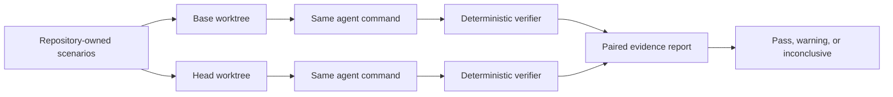

# EvolveCI

EvolveCI tests whether a pull request makes the **next plausible change** harder.

Most CI answers, “Does this code work now?” EvolveCI runs the same maintainer-approved follow-up task against the base and head revisions in isolated Git worktrees, verifies both results, and compares the actual cost of the generated patches.

> EvolveCI produces evidence about selected future-change probes. It does not predict future requirements.

## The one-minute model



The alpha measures:

- probe success or failure;
- agent and verifier duration;
- files and lines changed;
- total patch churn;
- test files modified;
- dependencies introduced.

Every result includes the raw logs and changed paths. There is no opaque “AI maintainability score.”

## Current status

This repository is an executable alpha. It includes the local CLI, YAML configuration validation, safe argv-based process execution, detached worktree isolation, paired base/head orchestration, threshold evaluation, JSON and Markdown reports, and integration tests.

It intentionally does **not** yet include a hosted runner, GitHub App, model billing, Docker isolation, or scenario generation.

## Install for development

```bash
npm install
npm run check
```

After the package is published, install the CLI in a repository with:

```bash
npm install --save-dev @avee1234/evolveci
npx evolveci --version
```

## Configure a repository

Create `.evolveci/scenarios.yaml`:

```yaml
version: 1

# Optional. Runs once in each detached scenario worktree.
setup: ["npm", "ci"]

agent:
  # Commands are argv arrays. EvolveCI never interpolates them through a shell.
  command: ["evolveci", "adapter", "codex"]
  timeoutMs: 600000
  # Default-deny inherited environment. Allow only credentials the adapter needs.
  inheritEnvironment: false
  passEnvironment: []
  # Use stdin for agents that support it so large prompts never hit env limits.
  promptTransport: stdin
  # Parse exact token usage from the built-in Codex adapter's JSONL stream.
  telemetryFormat: codex-jsonl

execution:
  repetitions: 3
  maxCoefficientOfVariationPercent: 30

thresholds:
  maxAddedFiles: 2
  maxDurationIncreasePercent: 50
  maxChurnIncreasePercent: 50
  maxAddedTestFiles: 0
  maxAddedDependencies: 0
  maxChangedDependencies: 0
  maxTokenIncreasePercent: 50

scenarios:
  - id: add-enterprise-auditor
    prompt: >-
      Add a read-only enterprise auditor role without changing existing role behavior.
    verify: ["npm", "test", "--", "tests/auditor-role.test.ts"]
    timeoutMs: 600000
```

The agent receives a minimal runtime environment plus these variables:

| Variable | Meaning |
|---|---|
| `EVOLVECI_PROMPT` | Prompt when `promptTransport` is `environment` |
| `EVOLVECI_SCENARIO_ID` | Stable scenario identifier |
| `EVOLVECI_SIDE` | `base` or `head` |
| `EVOLVECI_REVISION` | Exact commit SHA |
| `EVOLVECI_REPOSITORY` | Original repository root |
| `EVOLVECI_WORKTREE` | Isolated worktree path |
| `EVOLVECI_ATTEMPT` | One-based repeat number |

The CLI does not expand `$EVOLVECI_PROMPT` inside command arguments. Agent adapters read the prompt from stdin or the environment. This avoids shell injection and keeps prompts containing quotes or newlines intact. Agent processes inherit only a small OS allowlist by default; add credential names to `passEnvironment` only when required.

### Built-in Codex adapter

The package ships a vendor-specific adapter without coupling the comparison engine to Codex:

```yaml
agent:
  command: ["evolveci", "adapter", "codex", "--model", "gpt-6-astra"]
  promptTransport: stdin
  inheritEnvironment: false
```

It invokes `codex exec` in ephemeral, workspace-write mode, streams the scenario through stdin, and emits Codex JSONL into the evidence logs. Authentication continues to use the normal Codex home directory. The adapter never enables the dangerous sandbox-bypass flag.

With `telemetryFormat: codex-jsonl`, EvolveCI reads only complete `turn.completed` records and reports median input-plus-output tokens. Cached and reasoning token details remain in `report.json`. Truncated or malformed streams produce no token claim. EvolveCI does not infer the served model or estimate dollar cost.

See [the adapter contract](docs/ADAPTERS.md) to integrate another coding agent.

## Run

```bash
npm run build
node dist/src/cli.js validate --repo /path/to/repo
node dist/src/cli.js run \
  --repo /path/to/repo \
  --base origin/main \
  --head HEAD \
  --output .evolveci/runs/latest
```

Exit codes are designed for CI:

| Code | Meaning |
|---:|---|
| `0` | Comparable probes passed configured thresholds |
| `1` | Invalid input, Git failure, setup failure, or internal error |
| `2` | Evolvability warning or critical regression |
| `3` | No scenario produced a comparable base/head pair |

## Run the deterministic demo

```bash
npm run demo
```

The demo creates a temporary permissions service with two revisions. Both preserve the current admin/member behavior, but the head revision replaces the role registry with tightly coupled conditionals. A deterministic fixture agent then runs three future role changes against both revisions, three times each. The base needs one changed file per scenario; the head needs four, including a test fixture. EvolveCI reports the regression and saves its evidence under `demo/output/`.

This fixture is intentionally deterministic: it proves the orchestration and report semantics without spending model tokens. The next validation milestone is repeating the same experiment with pinned real coding-agent adapters.

## Evidence bundle

Each run produces:

```text
.evolveci/runs/latest/
├── report.json
├── report.md
├── report.html
└── logs/
    └── <scenario>/
        ├── base/attempt-1/
        └── head/attempt-1/
```

The report is deliberately decomposable. Reviewers can see which scenario regressed, the exact metric, both values, verifier output, and agent logs.

## Safety boundaries

- Agent and verifier commands use `spawn(..., { shell: false })`.
- Scenarios run in temporary detached worktrees, not the developer's checkout.
- Worktrees are removed after every scenario, including failed runs.
- Output capture is bounded to avoid unbounded memory use.
- Truncated stdout and stderr are explicitly marked in JSON evidence.
- A timed-out command receives `SIGTERM`, followed by `SIGKILL` after one second.
- Configuration requires argv arrays instead of command strings.
- Agent subprocesses do not inherit arbitrary secrets unless explicitly allowed.
- Repeated runs use medians and become inconclusive when duration variance exceeds the configured limit.

Worktree isolation is not a security sandbox. Before running untrusted agents or repositories, the next milestone is container or microVM isolation with explicit network, CPU, memory, and filesystem policies.

## Roadmap

1. Prove the paired mechanism with a purpose-built demo repository.
2. Add repeat runs, medians, variance, and an inconclusive confidence rule.
3. Add Codex and Claude Code adapters with token/turn accounting.
4. Add container isolation and environment caching.
5. Add a label-triggered GitHub Action that uploads the evidence bundle.
6. Validate on public repositories before building a hosted product.

See [the executable specification](docs/SPEC.md) and [implementation plan](docs/IMPLEMENTATION_PLAN.md).

## License

Apache-2.0
